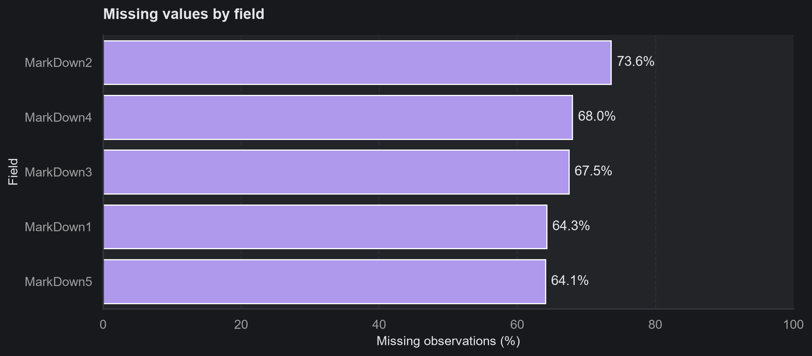
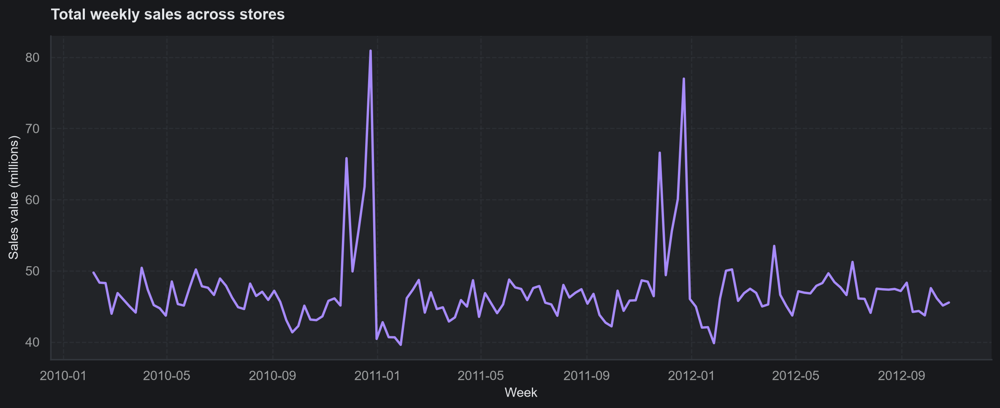
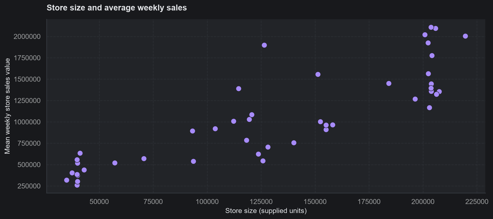
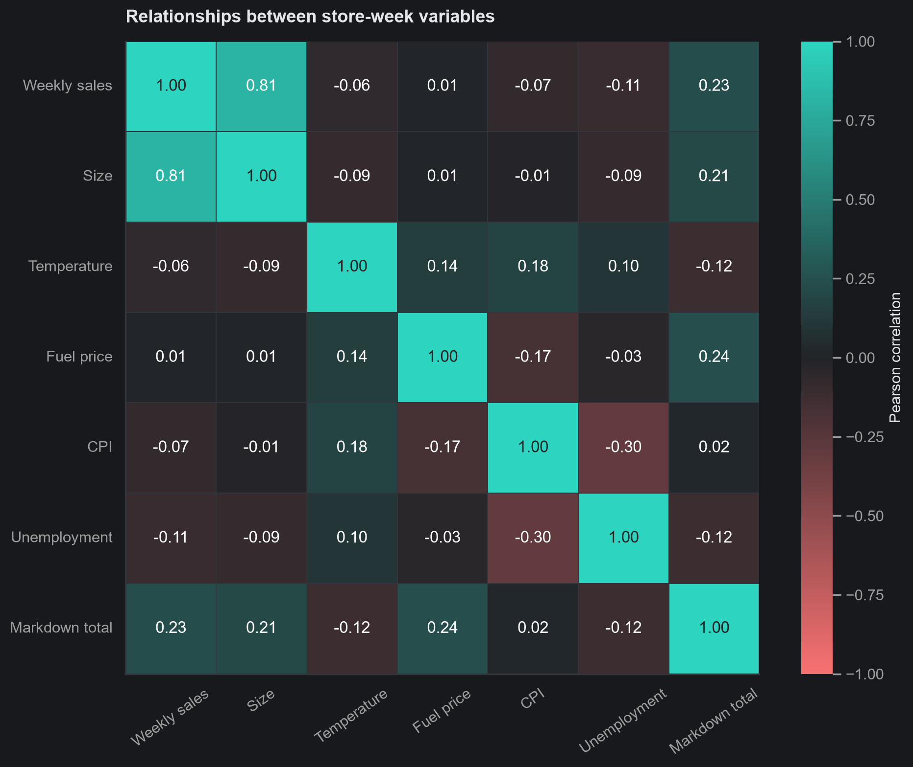
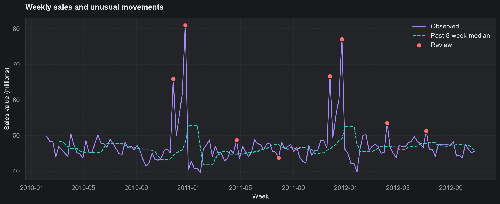
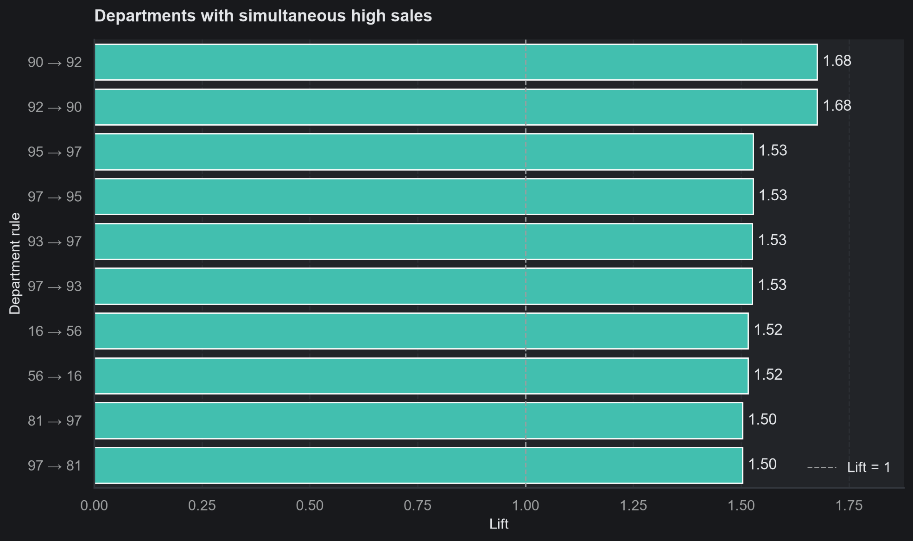
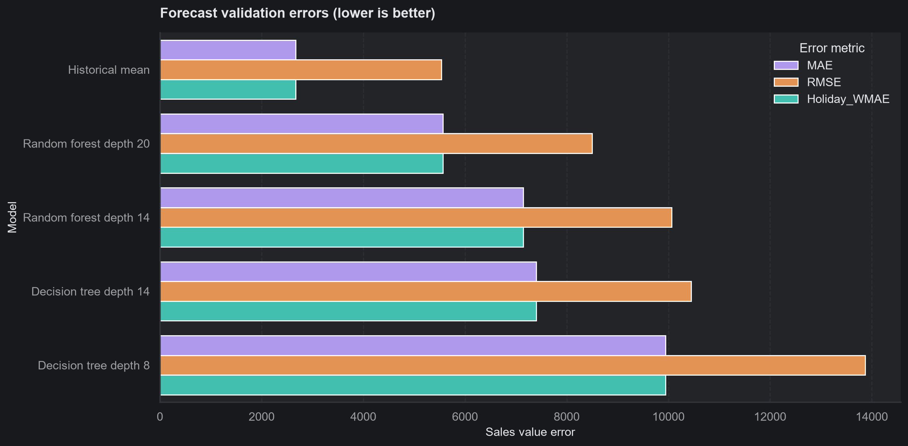
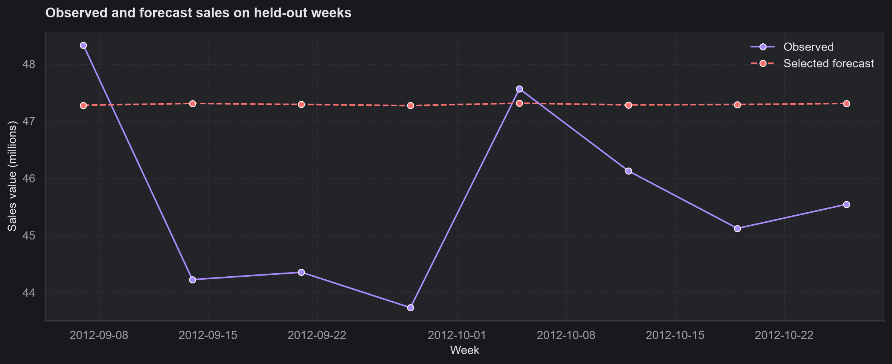

# Integrated Retail Analytics for Store Optimization and Demand Forecasting

## Executive summary

This project analyzes 421,570 weekly store-department sales records from 45 stores and 81 departments, covering 5 February 2010 to 26 October 2012. The objective is to improve the evidence available for inventory planning, store-level marketing and sales forecasting. The supplied data includes store characteristics, five anonymized markdown fields, temperature and economic indicators.

The workflow combines data validation, ten exploratory charts and five analysis/evaluation charts, three hypothesis tests, interpretable anomaly rules, K-means store segmentation, a department co-movement proxy and chronological sales forecasting. The completed notebook contains the code and rendered outputs; this report explains the business reasoning and practical limitations.

The main exploratory findings are strong differences in store scale, seasonal peaks and considerable missingness in markdown fields. The best tested store segmentation has two groups, with a silhouette score of 0.345. Department pairs show simultaneous high sales, but there are no customer transactions and therefore no evidence of actual basket purchases. Historical store-department averages outperform the tested trees on validation and are selected, with held-out MAE of 2,266.30. A separate 26-week seasonal baseline improves over historical means on its own evaluation block. The historical and seasonal baselines provide useful reference forecasts.

## 1. Business problem and data scope

A retailer needs to identify unusual sales, anticipate weekly revenue and target operational reviews. Forecast errors can create poor stock decisions, while mistaken anomaly removal can erase real holiday peaks. Store profiles can support more relevant campaigns, and department co-movement can suggest ideas for controlled trials.

The outcome is weekly monetary sales. It is not directly a forecast of physical units or unconstrained demand: stockouts, product prices, margins, lead times and customer baskets are absent. Recommendations are therefore planning proposals rather than demonstrated profit improvements.

**Repository:** https://github.com/saiabhiram-simhadri/integrated-retail-analytics-store-optimization

## 2. Data understanding and preprocessing

| Input | Rows | Level |
|---|---:|---|
| sales.csv | 421,570 | Store-department-week |
| Features.csv | 8,190 | Store-week, including dates beyond the sales labels |
| stores.csv | 45 | Store |

All dates are parsed explicitly as day/month/year. The sales table is left-joined to features on Store and Date and then to stores on Store. Many-to-one validation prevents duplicate feature or store rows from multiplying observations. Every sale matched its store-week features, holiday flags agreed, and the joined row count stayed equal to the input sales count. No duplicate sales keys were found.

The notebook reports column types, descriptive statistics, unique counts, missing counts and sample rows before modeling. There are 1,285 negative sales entries. These are retained as possible returns or adjustments rather than being assumed invalid. Missing markdowns are zero-filled for modeling with a separate missingness flag. Other numeric fields use medians fitted separately within each training fold.

Store, department and format are categorical predictors. Calendar features include year, month, ISO week and elapsed week number. Store size, temperature, CPI, unemployment, fuel prices and promotion fields provide additional context. No current-week sales aggregate or target-derived anomaly flag is used as a forecasting input.

*Figure 1. Missing promotion reports require an explicit modeling assumption; zero filling does not prove that no promotion occurred.*

## 3. Exploratory analysis and visual storytelling

The ten exploratory charts cover missingness, sales distribution, weekly and monthly patterns, holidays, department rankings, store size, promotions, numeric correlations and relationships by store type. Five further charts show anomaly flags, store segments, department associations, validation metrics and held-out forecasts. Temperature and economic indicators are examined in the correlation heatmap; the pair plot also shows temperature and store type.

The sales distribution is right-skewed, so average and median sales describe different aspects of performance. The distribution chart limits its display to nonnegative observations below the 99th percentile; it does not delete the excluded rows from analysis. Weekly sales have visible seasonal spikes, so high values require investigation before correction.

*Figure 2. Chain-level weekly sales provide seasonal context. The notebook prints the exact highest-sales week and its value.*

Monthly means reduce the distortion from unequal numbers of observed weeks, but the series contains incomplete calendar years and changing department coverage. Holiday/nonholiday mean comparisons use the supplied flag, which does not capture every seasonal occasion. Neither chart isolates a causal effect.

Store size is strongly associated with average store-week sales (Pearson correlation approximately 0.85). Type A has the highest average store-week sales. Format, size and department mix overlap, so these differences do not establish store efficiency or the return on expansion.

*Figure 3. Larger stores tend to sell more, with considerable variation across individual stores.*

Recorded total markdowns have a positive store-week correlation with sales (approximately 0.23). Temperature has a weak aggregate correlation (approximately −0.06). CPI, unemployment and fuel-price correlations with store-week sales are approximately −0.07, −0.11 and 0.01. These descriptive associations do not establish causal contributions. Large stores and seasonal timing can confound promotion comparisons.

Promotion amounts are aggregated once per store-week. Summing the feature values once per sales row would duplicate the same promotion information across departments and exaggerate totals.

*Figure 4. Numeric relationships are interpreted jointly; a weak aggregate coefficient does not prove a variable is irrelevant within a department or season.*

Every notebook chart states its purpose, observed finding and practical implication or downside. A consistent dark seaborn theme, readable axis labels and selected bar annotations make the figures easier to compare. Figures are saved as 200-DPI PNGs with the custom dark background and tight margins in outputs/figures/. Chain-level time plots show sales in millions; the underlying analysis uses the original sales values.

## 4. Exploratory hypothesis testing

Three two-sided tests use a 5% level with Bonferroni correction for three questions. Each store contributes one summary or one paired comparison, avoiding the assumption that all department-weeks are independent.

| Question | Method | Adjusted p-value | Decision |
|---|---|---:|---|
| Holiday versus nonholiday store means | Wilcoxon signed-rank | 1.30 × 10⁻¹⁰ | Reject H0 |
| Store size versus average weekly sales | Spearman correlation | 8.45 × 10⁻¹³ | Reject H0 |
| Positive recorded markdown versus zero/unreported weeks | Wilcoxon signed-rank | 0.000574 | Reject H0 |

The Spearman size-sales statistic is about 0.845. These results suggest systematic associations in the observed data. Stores still share seasonal and economic exposure, and recorded-promotion availability is confounded by time. Statistical significance is not campaign effectiveness, practical effect size or proof of causality.

## 5. Anomaly detection and handling

The first anomaly model fits Q1 and Q3 to each training store-department series. Values outside Q1 − 3×IQR or Q3 + 3×IQR are flagged. The conservative multiplier avoids automatically labeling every large sale as an error. Bounds and fit dates are saved as a reusable artifact.

The notebook prints holiday-specific flag rates and the largest positive deviations alongside dates and markdown totals. The fitted IQR rule flags 7,141 observations (about 1.69% of rows), and the store-department trailing rule flags 26,169 observations (about 6.21%). These counts are review volumes, not verified error counts. Date and promotion fields help form hypotheses about holiday demand, promotions, returns or reporting issues; the dataset cannot confirm the cause.

A separate time-based rule uses each series' preceding eight observed weeks, with a minimum of four, to calculate a median and standard deviation. A one-row shift ensures the current observation does not define its own reference. Absolute deviations above three past standard deviations are review candidates. Missing calendar weeks mean eight observations may span more than eight weeks. The chain-level chart uses the same trailing logic.

*Figure 5. Flags identify weeks to review, including possible legitimate seasonal changes.*

Original sales remain the target in the main experiment. A fixed decision-tree diagnostic compares raw targets with training-only IQR clipping on the first validation block. Validation and test sales are never clipped. Review the diagnostic table before recommending correction. There are no verified anomaly labels, so the project does not invent precision or recall scores.

## 6. Store segmentation and personalization

Customer-level segmentation is impossible with these files. K-means instead groups stores using six training-period features: mean weekly store sales, sales standard deviation, store size, recorded markdown mean, CPI and unemployment. Median imputation and standardization precede clustering so units do not dominate distances.

| k | Silhouette |
|---:|---:|
| 2 | 0.345 |
| 3 | 0.250 |
| 4 | 0.304 |
| 5 | 0.310 |

Two clusters score best among the tested options. Inertia is also reported; it falls as more groups are allowed and is not by itself a reason to select the largest k. Separation is moderate, and results are exploratory with only 45 stores.

| Segment | Stores | Mean weekly store sales | Mean weekly sales SD | Mean store size | Mean recorded markdown |
|---|---:|---:|---:|---:|---:|
| 0 | 23 | 606,588 | 81,623 | 85,509 | 2,711 |
| 1 | 22 | 1,509,661 | 222,148 | 177,102 | 7,092 |

*Figure 6. The groups largely distinguish store scale, with overlap and within-group variation.*

Segment 1 supports an availability-focused planning pilot because its larger absolute sales variation can create substantial misses. Segment 0 supports smaller initial commitments and tightly scoped campaigns. Segment numbers are arbitrary labels. These proposals should be checked at the department level; clustering does not prove which promotion will work.

## 7. Department association proxy and cross-selling

No actual basket analysis is possible. The project defines a proxy high-sales event when a department exceeds its training store-department median during a store-week. Only departments observed in at least 90% of training store-weeks are considered. Each pair uses weeks with both departments observed.

Support is the joint event rate. Confidence A→B is the joint event rate divided by A's event rate. Lift divides that confidence by B's event rate. Rules must meet support ≥ 0.10, confidence ≥ 0.50 and lift > 1.

The leading pair is departments 90 and 92. Across 5,355 co-observed store-weeks, support is approximately 0.412, confidence about 0.831 and lift about 1.677. The reverse rule is also reported; the pair is not two independent discoveries. Departments 95 and 97 also show high co-movement.

*Figure 7. High-sales lift suggests shared patterns, not confirmed joint customer purchases.*

Map IDs to real department categories before proposing displays. Shared seasonality can generate high lift. Test an appropriate campaign with a control group and measure incremental margin before expanding it.

## 8. Demand forecasting, validation and tuning

The primary evaluation uses an ordered split:

| Split | Weeks | Rows | Dates |
|---|---:|---:|---|
| Initial training | 119 | 350,595 | 2010-02-05 to 2012-05-11 |
| Validation | 16 | 47,246 | 2012-05-18 to 2012-08-31 |
| Final test | 8 | 23,729 | 2012-09-07 to 2012-10-26 |

Validation contains two expanding eight-week blocks. All observations in a week stay together. For each fold, imputation, category encoding and model fitting use only earlier weeks. Full-period EDA is descriptive and is not used to fit the models.

The historical-average baseline predicts each store-department's past mean and falls back to the global training mean for unseen pairs. Decision trees compare depths 8 and 14, with a minimum of 20 rows per leaf. Random forests compare depths 14 and 20 using 40 trees, a minimum of 10 rows per leaf and random seed 47. This is a small, interpretable parameter comparison rather than an expensive search.

Select by mean validation MAE. MAE is the average currency error per store-department-week; RMSE emphasizes large misses. Holiday WMAE gives supplied holiday observations five times the weight of ordinary weeks. MAPE is avoided because sales may be zero or negative. Refit the selected method on all pre-test weeks, then assess once on the final test.

The notebook includes a separate fixed-tree diagnostic comparing external inputs to calendar/store-only predictors. Observed historical temperature, economics and actual markdown values are not necessarily known when an operational forecast is made. Results using those fields are conditional estimates; real planning needs scenarios or planned values.

### Measured forecast results

| Configuration | Validation MAE | Validation RMSE |
|---|---:|---:|
| Historical mean | 2,665.83 | 5,538.43 |
| Random forest, depth 20 | 5,565.71 | 8,500.67 |
| Random forest, depth 14 | 7,146.47 | 10,060.52 |
| Decision tree, depth 14 | 7,403.76 | 10,446.48 |
| Decision tree, depth 8 | 9,942.37 | 13,872.76 |

Increasing depth reduced decision-tree MAE by 2,538.60 and random-forest MAE by 1,580.76, but neither family beat the baseline. With many one-hot identifiers, these constrained trees have difficulty capturing the store-department differences that historical means represent directly. This is an interpretation of the tested models, not a universal claim about forests. The tested tree models did not meet the baseline-improvement criterion.

There are no supplied holiday weeks in validation. Consequently holiday WMAE equals MAE in both folds and does not establish holiday forecasting quality.

*Figure 8. The simplest method has the lowest validation error.*

The historical mean was selected using validation only. Its held-out performance is:

| Selected method | Test MAE | Test RMSE | Test holiday WMAE |
|---|---:|---:|---:|
| Historical store-department mean | 2,266.30 | 4,394.57 | 2,431.31 |

The selected method is the baseline itself, so its improvement over that baseline is exactly zero. The final test includes the supplied holiday week ending 7 September 2012. One holiday week is limited evidence for other holiday periods.

*Figure 9. Aggregate sales and selected forecasts over the final eight weeks. Aggregate alignment can hide department errors; the notebook also reports format and segment error summaries.*

The fixed-tree diagnostics on the first validation block are:

| Diagnostic | MAE |
|---|---:|
| Raw target and external fields | 7,543.27 |
| Training-IQR-clipped target and external fields | 7,487.42 |
| Raw target and calendar/store fields only | 7,520.03 |

Clipping improves this tree's MAE by only 55.84, approximately 0.74%, while remaining far worse than the mean baseline. That does not justify removing all flagged sales. The external-input version is slightly worse than the calendar/store-only version in this experiment; the project therefore does not claim that external inputs improve forecasting.

The 26-week seasonal experiment gives:

| Method | MAE | RMSE | Holiday WMAE |
|---|---:|---:|---:|
| Historical mean | 3,384.78 | 9,599.64 | 3,917.01 |
| Exact 52-week seasonal persistence with fallback | 2,063.45 | 4,622.95 | 2,159.53 |

Seasonal lookup covers 96.87% of this block; other rows use a training-only mean fallback. Its MAE is about 39.04% lower than the mean on this same 26-week block. This is a different evaluation period from the final eight-week test, so its score cannot be directly used to claim superiority on that final test. Further chronological evaluation would be required before replacing the selected primary model.

## 9. Longer-horizon forecasting and saved models

A separate 26-week block ending before the primary validation period compares a historical mean with exact 52-week seasonal persistence. The seasonal forecast uses sales from 364 days earlier and a training-only mean fallback where that date is unavailable. Every referenced sales label predates the 26-week forecast origin. Coverage is reported rather than assuming every series has complete history.

This illustrates a practical distinction: calendar and seasonal baselines require no observed future economic fields, while the external-input models need forecast-time input plans. One historical block and fewer than three years of labels limit evidence for longer-term planning.

Saved artifacts include the selected sales forecaster, its input columns and training end date, the IQR anomaly bounds and the standardized K-means model. The forecaster is reloaded and checked against predictions from target-free test inputs. This is a reproducibility check, not evidence of production readiness.

## 10. Strategy and real-world challenges

1. **Inventory:** prioritize review of high-error departments and volatile stores. Convert sales forecasts to units only after obtaining prices, assortment and lead times. Do not calculate safety stock from sales currency alone.
2. **Anomalies:** use flags to investigate source logs, returns, promotions and holiday calendars. Correct verified errors and retain legitimate demand peaks.
3. **Marketing:** tailor small pilots to the measured store profiles. Keep promotion assumptions explicit and evaluate incremental margin rather than total sales alone.
4. **Cross-selling:** validate department mappings and campaign feasibility before acting on proxy rules.
5. **Store optimization:** compare formats and scale before declaring a store inefficient. Revenue rankings omit costs, margins and local demand.
6. **Monitoring:** track MAE, RMSE and holiday errors by department, format and segment. Reassess after assortment or promotion changes.

Key challenges include incomplete promotion histories, uncertain future inputs, no customer baskets, no stockout records and short time coverage. These prevent causal personalization claims and direct unit-level replenishment decisions. Use results to guide review and controlled pilots.
