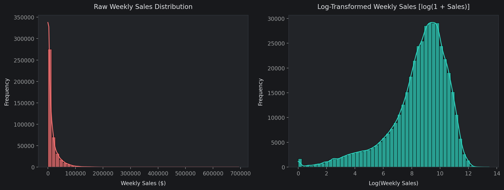
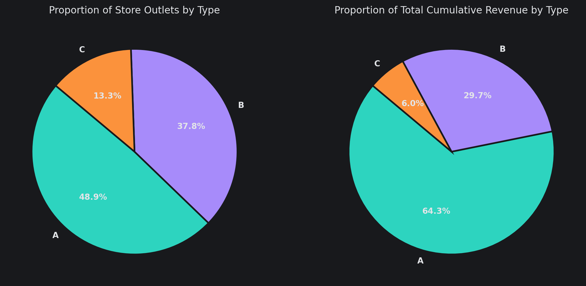
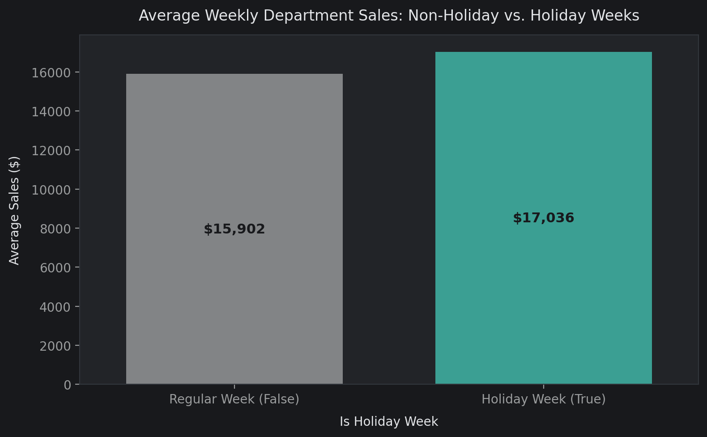
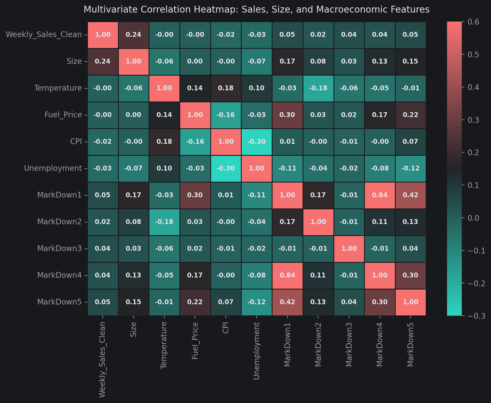
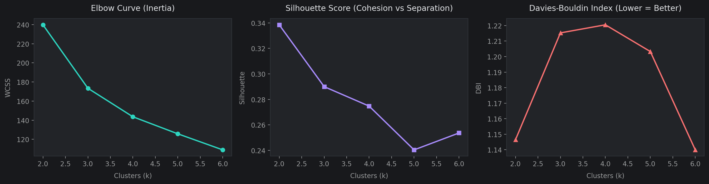
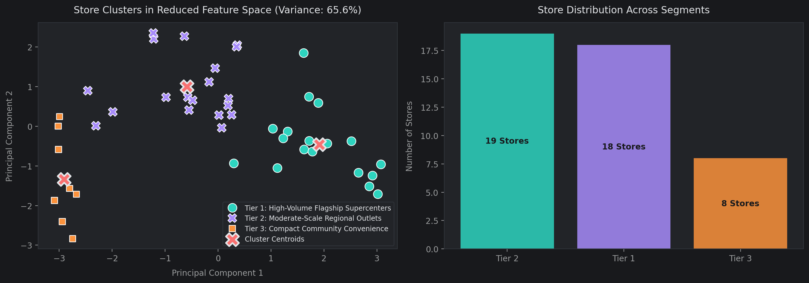
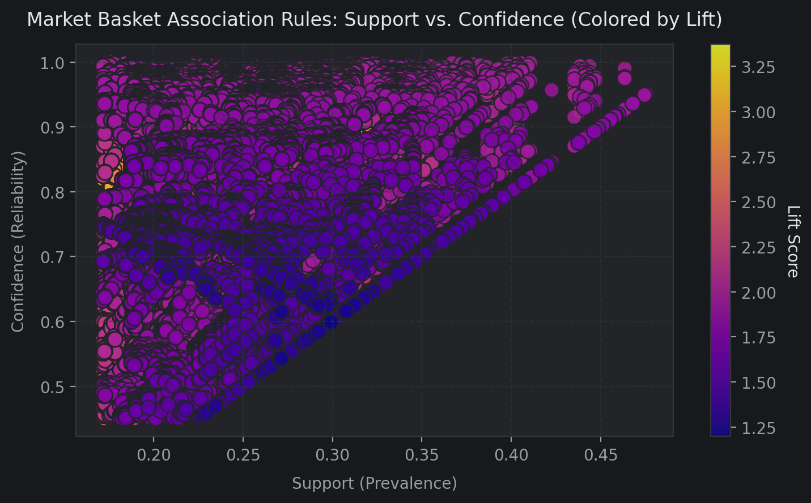
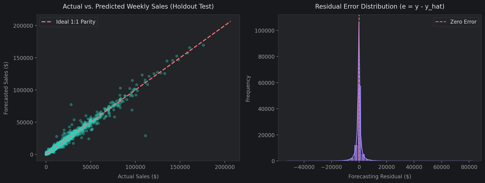
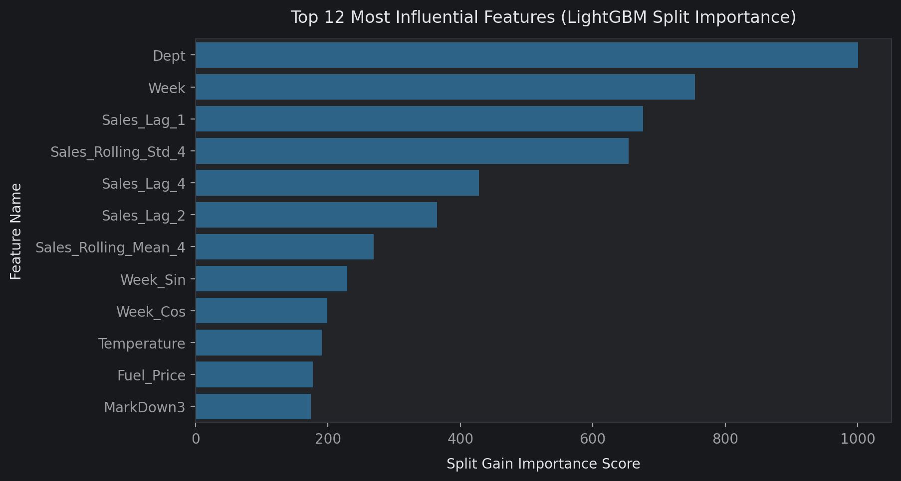

# Integrated Retail Analytics: Project Report

This report describes Integrated_Retail_Analytics_Store_Optimization.ipynb and its supplied saved outputs. The previous notebook's historical-mean forecasts, two-cluster solution, anomaly rules and evaluation periods do not apply to this analysis. Results below were transcribed from the new notebook; full training was not rerun during this documentation update.

## 1. Business problem and data

The project studies weekly department revenue to support store planning, anomaly review, format-specific merchandising and forecasting. It also illustrates inventory buffers. Revenue is observed sales, not unconstrained demand: no stockout labels, unit prices, physical quantities, supplier lead-time observations, customer identities or purchase baskets are available.

| Input | Rows | Grain |
|---|---:|---|
| sales.csv | 421,570 | Store-department-week |
| Features.csv | 8,190 | Store-week |
| stores.csv | 45 | Store |

Sales cover 143 weeks from 5 February 2010 through 26 October 2012. Features cover 182 dates, including weeks beyond available sales. Store format is coded A/B/C; business persona names are analytical interpretations rather than verified format definitions.

The notebook downloads CSVs from shared Google Drive links. Local supplied CSVs also exist under data/. Dates are parsed explicitly as DD/MM/YYYY. Sales are left-joined to stores by Store, then to features by Store and Date; the duplicate holiday column is removed. The resulting analytical mart has 421,570 rows and 23 columns. The current merge code does not explicitly validate join cardinality or holiday agreement.

The source tables report no duplicate rows. Features contain 24,040 missing values, including substantial markdown missingness and 585 missing values each for CPI and unemployment. Each markdown receives a presence indicator, then missing amounts are filled with zero. CPI and unemployment use per-store forward/backward filling before the later entity/date sort; this is not a training-only imputation procedure.

The 1,285 negative sales records (0.305%) receive an Is_Return_Adjustment flag. Raw Weekly_Sales is preserved, while Weekly_Sales_Clean clips negative values to zero. Consequently the clean target represents a modified revenue measure rather than original net revenue.

## 2. Exploratory analysis: 15 figures

All 20 figures from the integrated notebook are available in the [chart gallery](../outputs/figures/README.md). The first 15 cover distribution, format, promotions, weather, economics, time patterns, PCA and department relationships.

The first figure compares nonnegative cleaned sales with log(1 + sales). Although the left panel says raw sales, its code uses Weekly_Sales_Clean. Right skew makes average and typical department performance different concepts.

Physical-size box plots and outlet/revenue shares provide context for differences between formats. Mean weekly department sales are $20,099.77 for A, $12,237.33 for B and $9,519.64 for C. These are department-row averages, not total weekly store revenue. Store scale and department composition confound comparisons of efficiency.

Holiday rows average $17,036.09 versus $15,901.65 for ordinary weeks, an observed difference of $1,134.44 (about 7.13%). This association does not establish an incremental holiday or promotion effect.

The markdown distribution excludes zeros and suppresses displayed fliers. MarkDown1 versus sales uses up to 5,000 positive-event rows. Temperature and unemployment figures describe record-level exposure, while the dual-axis fuel plot compares weekly mean fuel price with chain sales. Features repeated across department rows weight these summaries by department coverage; markdown distributions do not measure unique store-week spending.

The correlation heatmap and signed target-correlation bars show linear associations. Size has a department-sales correlation of approximately 0.24. Weak macroeconomic correlations do not prove irrelevance, and split importances do not prove nonlinear causal effects. Type-specific time series reveal scale and seasonality. The first PCA projects four store summaries (mean sales, sales SD, size and mean MarkDown1 + MarkDown5); it differs from the later eight-feature clustering PCA. The department heatmap uses the top ten revenue departments with complete co-observed store-weeks.

## 3. Statistical tests

The notebook conducts three tests at alpha=0.05, without a multiple-test correction in its implementation.

| Question | Test | Statistic | Reported p-value |
|---|---|---:|---:|
| Holiday sales greater than regular sales | One-sided Welch t-test | 7.0012 | 1.2935e-12 |
| Equal mean sales across A/B/C | One-way ANOVA | 7,764.5205 | Printed as 0.0000e+00 |
| Active markdown independent of above-median sales | Chi-square, 1 df | 6.3712 | 0.011599 |

Printed zero is numerical underflow/display precision, not an exact zero probability. All three reject their null hypotheses under the notebook's nominal threshold. They operate on repeated department-week rows rather than independent store summaries: shared store, date and seasonal exposures weaken independence assumptions. Significance should therefore be treated as exploratory.

For inactive markdown rows, below/at-median and above-median counts are 134,676 and 135,462; active markdown counts are 76,110 and 75,322. The active group has a slightly lower above-median proportion (about 49.74% versus 50.15%). The test establishes association in this table, not promotional uplift.

## 4. Anomaly detection and target handling

The contextual detector computes a full-period median and standard deviation for each department and ISO week-of-year. Absolute residual Z above 3 flags 3,665 rows (0.87%): 3,664 positive surges and one negative drop. Among positive surges, 7.6% occur on supplied holidays and 33.3% have an active markdown. These fields provide context, not verified root causes.

Isolation Forest uses RobustScaler and six inputs: cleaned sales, size, temperature, fuel price, MarkDown1 and MarkDown5. With 150 estimators, contamination=0.015 and seed 47, it flags 6,324 rows (1.50%). The contamination setting partly determines review volume; no verified anomaly labels support precision or recall claims.

Weekly_Sales_ModelReady starts from the clipped target. A negative-drop rule proposes seasonal-median replacement except for return adjustments, but the recorded run imputes **zero** rows. It winsorizes 2,280 positive surges having neither a holiday flag nor total markdown expenditure, using each department's full-period 99th percentile. Other surges are retained. Isolation Forest flags are descriptive and excluded from forecasting inputs; they do not drive this winsorization.

These rules do not demonstrate stockouts or data corruption. Full-period seasonal statistics and percentiles include holdout information and also modify holdout targets. This is a material limitation for independent forecasting assessment.

## 5. Store segmentation

Eight full-period store features feed StandardScaler and K-means: mean department sales, department-sales SD, size, mean total markdown, holiday/regular sales ratio, mean department sales divided by store area, unemployment and CPI. Sales volatility here pools department rows and weeks; it is not the standard deviation of total weekly store sales.

The notebook plots inertia, silhouette and Davies-Bouldin diagnostics for k=2 through 6, then explicitly sets k=3 with n_init=20. It does not programmatically choose the silhouette maximum; the former analysis's k=2 and silhouette 0.345 are not applicable.

| Persona, ranked by mean sales | Stores | Mean weekly department sales ($) | Mean area (sq ft) | Mean recorded markdown ($) | Holiday ratio |
|---|---:|---:|---:|---:|---:|
| High-volume flagship | 18 | 22,700.25 | 191,117.06 | 9,331.87 | 1.07 |
| Moderate-scale regional | 19 | 11,281.77 | 110,525.53 | 5,805.83 | 1.10 |
| Compact community | 8 | 8,970.64 | 40,356.25 | 709.71 | 1.00 |

The notebook's sales-per-square-foot values are 0.12, 0.11 and 0.22. Their numerator is average department-row sales, so they should not be presented as whole-store sales density. Markdown means similarly reflect repeated store-week values weighted by department coverage. Personas describe stores, not customers, and their names do not establish specific assortments or shopping missions.

Use these groups to frame controlled availability and campaign pilots. Larger-volume stores may justify closer error monitoring; compact outlets may warrant smaller initial commitments. The clustering does not demonstrate an optimal campaign or inventory policy.

## 6. Department co-movement through Apriori

The top 12 departments by cumulative cleaned revenue form a Store-Date pivot. A high-sales event means a department exceeds its full-period department-wide median, shared across stores. Missing observations become false when compared to the median. Unlike a store-specific threshold, this can encode persistent differences in store scale.

Apriori uses minimum support 0.15 and yields 4,095 itemsets. Association rules initially require lift >=1.1, then confidence >=0.45 and lift >1.15; 503,958 rules remain. The leading displayed rule has support 0.187568, confidence 0.908202 and lift 3.372347. It is a multi-department rule, not a simple category pair. Many related rules share itemsets, so the count is not a count of independent discoveries.

Support is the joint event rate; confidence is the conditional consequent rate given the antecedent; lift compares confidence to consequent prevalence. Shared seasonality and store scale can produce lift without joint purchases. The scatter visualizes the complete filtered rule table, which is dense. Map department IDs to real categories and use simpler, stable rules in controlled tests before proposing cross-selling or layout changes. No customer-basket or incremental-margin outcome is observed.

## 7. Forecast design and results

Feature engineering sorts by Store, Dept, Date and adds ISO week/month/year, sine/cosine seasonality, sales lags of 1/2/4 observations, and shifted four-observation rolling mean and SD. Gaps can make lags differ from exact calendar-week lags. Promotion totals/counts and store format dummy variables are included. After 13,134 warm-up rows are removed, 408,436 rows and 43 columns remain.

The split uses the 80th percentile of unique dates. Target-derived anomaly and adjustment columns are excluded, leaving 33 predictors, including numeric store/department IDs.

| Partition | Dates | Rows |
|---|---|---:|
| Training | 5 March 2010–13 April 2012 | 325,663 |
| Holdout | 20 April 2012–26 October 2012 | 82,773 |

The target is Weekly_Sales_ModelReady. WMAE = sum(w * absolute error) / sum(w), with w=5 for supplied holiday rows and 1 otherwise. This is an evaluation weighting; the models are not trained with holiday sample weights.

Ridge uses StandardScaler and alpha=10. Random Forest uses 100 trees and max_depth=14. Default LightGBM uses 250 trees, learning_rate=0.06, max_depth=8, num_leaves=63, subsample=0.8 and colsample_bytree=0.8. Seed is 47.

| Model | Train WMAE ($) | Test WMAE ($) | Test RMSE ($) | Test MAE ($) | Test R² |
|---|---:|---:|---:|---:|---:|
| Ridge | 2,901.52 | 1,808.42 | 3,271.17 | 1,778.71 | 0.9778 |
| Random Forest | 1,580.94 | **1,471.72** | 2,988.12 | **1,404.11** | 0.9815 |
| Default LightGBM | 1,656.75 | 1,484.42 | **2,944.74** | 1,436.34 | **0.9820** |
| Tuned LightGBM | Not printed | 1,491.80 | 2,967.83 | Not printed | 0.9818 |

Random Forest lowers WMAE by about 18.62% versus Ridge. Default LightGBM leads RMSE and R². The notebook nevertheless exports tuned LightGBM; it should not be described as the best WMAE model.

RandomizedSearchCV evaluates six LightGBM configurations using three TimeSeriesSplit folds and negative unweighted MAE. The selected configuration is num_leaves=31, n_estimators=200, max_depth=12, learning_rate=0.08 and colsample_bytree=1.0. Tuned test WMAE worsens by $7.38 versus default LightGBM and by $20.08 versus Random Forest. The current source does not supply a tuned MAE or CV score table; none is inferred here.

The parity plot samples up to 2,000 holdout rows; the histogram shows adjusted-target residuals. LightGBM's default feature_importances_ reports split counts. The plot's axis label says gain importance, but the estimator does not request gain importance; interpret this figure as split frequency, not causal contribution or gain.

### Validation limitations

The outer split is chronological, but the data passed to TimeSeriesSplit remains sorted by store and department, then date. Row-based folds therefore do not create globally chronological cutoffs across stores. Search scoring also differs from the stated WMAE priority.

Full-period anomaly treatment uses future data and adjusts test labels before scoring. Holdout lags and rolling features include earlier observed holdout targets, so this resembles rolling prediction with updated actuals rather than a single 28-week forecast issued at the cutoff. Actual current-week promotions and macroeconomic inputs also require forecast-time availability assumptions.

To validate operational performance, fit preprocessing inside date-grouped training folds, evaluate on original sales, define the forecast horizon and input availability, and choose the estimator on validation WMAE before one final untouched test. These corrections would change the experiment and require new results; the reported numbers above preserve the supplied notebook run.

## 8. Inventory illustration and serialization

The notebook pools tuned-LightGBM holdout residuals by department across stores. It assumes two-week lead time and z=1.645, and calculates:

- Safety stock dollars = ceil(1.645 * residual SD * sqrt(2)).
- Reorder point dollars = ceil(2 * mean weekly forecast + safety stock dollars).

| Department | Mean forecast ($) | Residual SD ($) | Safety stock ($) | Reorder point ($) |
|---|---:|---:|---:|---:|
| 92 | 77,535.96 | 7,798.83 | 18,144 | 173,216 |
| 95 | 73,848.87 | 5,671.29 | 13,194 | 160,892 |
| 38 | 61,091.37 | 7,085.73 | 16,485 | 138,668 |
| 65 | 48,370.50 | 3,648.14 | 8,487 | 105,229 |
| 90 | 45,921.96 | 3,334.00 | 7,757 | 99,601 |

These are dollar proxies based on average department-row forecasts, not chain department totals or physical inventory units. Pooling across stores loses local variability. Normal-error and independent-week assumptions are not validated; z=1.645 is an assumed nominal service factor, not evidence of 95% realized on-shelf availability. Buffers calibrated using holdout residuals need separate future validation. Obtain quantities, prices, lead-time distributions, stock availability and store-specific errors before implementing replenishment.

The serialization cell writes models/retail_demand_forecaster.joblib, containing the tuned estimator, ordered 33-feature list, test WMAE/RMSE/R², service factor, seed and training cutoff. It reloads the estimator and predicts three rows. The supplied notebook records a 565.95-KB artifact and forecasts $33,079.38, $20,780.23 and $32,301.70. The actual integrated artifact is absent from the repository at this update; these are recorded outputs, not a newly reproduced file. Existing sales_forecaster, anomaly_model and store_segmentation artifacts are legacy and must not be used as the integrated models. The new notebook does not serialize its Isolation Forest or K-means models.

## 9. Chart exports and reproduction status

The notebook now includes a chart-export setup appendix importing retail_chart_exports.py. Run it once before an ordered analysis rerun. It exports all 20 embedded PNGs and enables live saving at 200 DPI before plt.show(), preserving figure background and tight bounds. Reset setup before another ordered run. Initial image extraction preserves the saved inline resolution; it does not rerender charts at 200 DPI. The [gallery](../outputs/figures/README.md) maps every filename to its analysis.

This update validates the helper, image inventory and documentation references, but does not rerun expensive training, Apriori or model serialization. The existing notebook's recorded metrics and figures are preserved. Superseded notebooks and old charts have been removed; outputs/figures/ contains the current chart set.

## 10. Practical use

Prioritize anomaly review using source records rather than automatically interpreting flags as stockouts. Use store personas and co-movement rules to frame small controlled pilots. Track raw-target errors by store, department, holiday and horizon. Resolve the validation limitations before claiming model superiority in deployment, then calibrate physical inventory buffers on new periods. No measured revenue uplift, margin improvement or service-level guarantee is established by the current data.

