# Integrated notebook chart gallery

These 20 PNGs are extracted from the integrated notebook's saved outputs. Initial snapshots retain their embedded resolution. Run the notebook's export setup appendix before an ordered analysis rerun to enable fresh 200-DPI exports. See [the report](../../docs/project_report.md) for interpretation and validation limits. The superseded chart set has been removed.

## Cleaned and log-transformed sales

The left panel uses clipped sales despite its raw-sales title.

## Store physical size by format

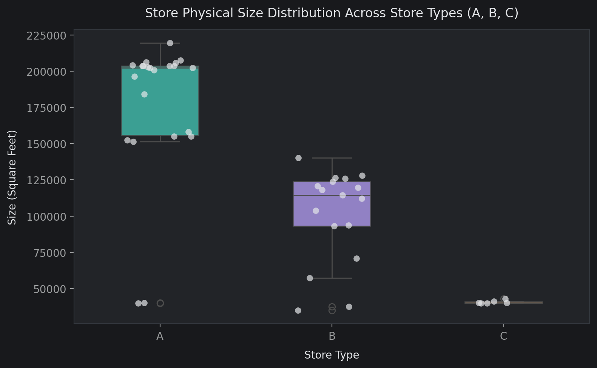

Box and individual store observations.

## Outlet and revenue shares by type

Cumulative revenue shares reflect store count and size.

## Active markdown distribution

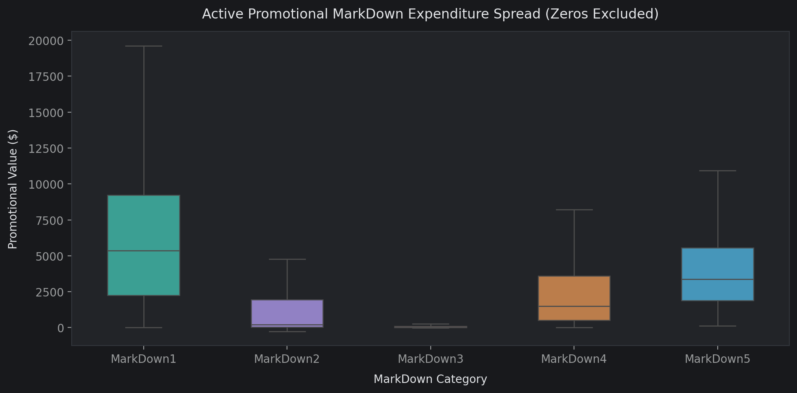

Zeros excluded; fliers hidden; department-row weighting.

## Temperature exposure

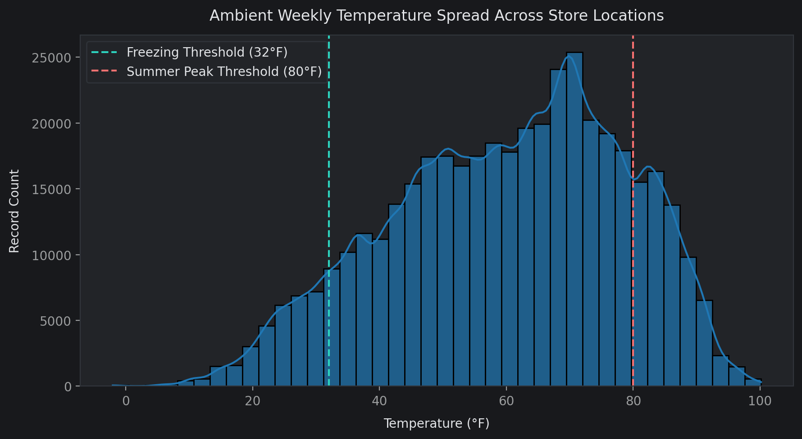

Store-week context repeats across department rows.

## Mean department sales by format

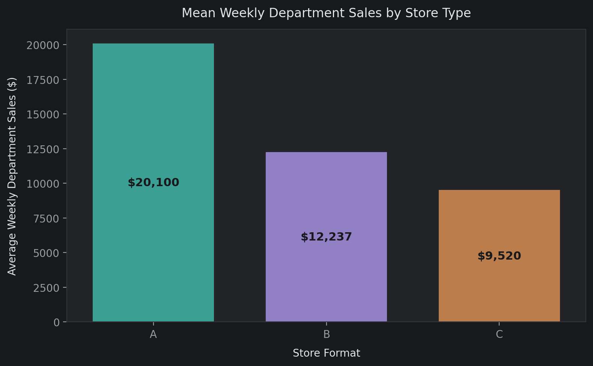

Department-row means, not total weekly store sales.

## Holiday versus regular mean sales

Descriptive association, not causal uplift.

## Fuel price and chain sales

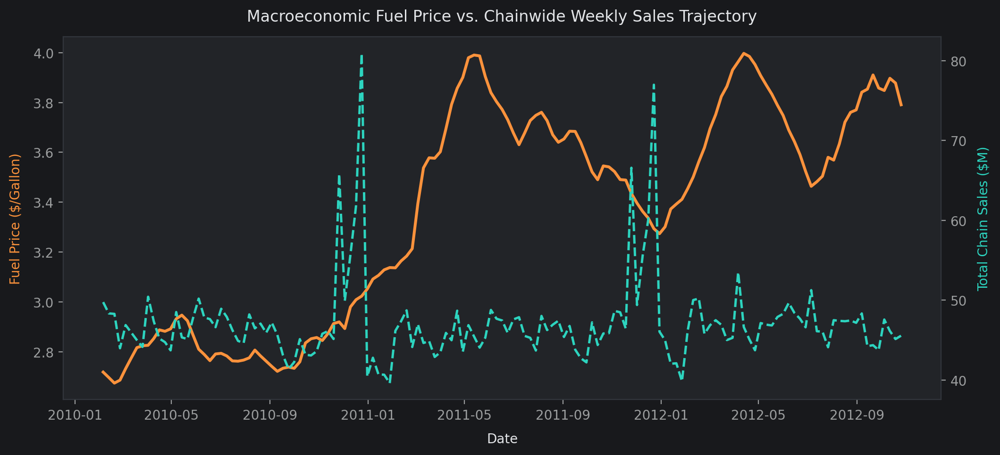

Separate axis scales; timing alone does not imply causality.

## Active MarkDown1 versus sales

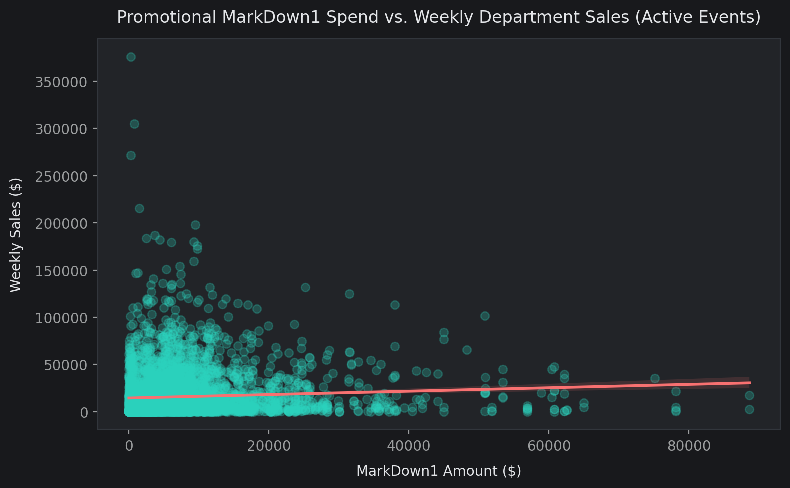

Sample of up to 5,000 positive-event rows.

## Unemployment and sales

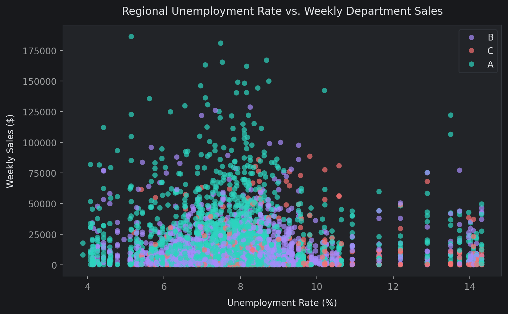

4,000 sampled rows colored by store format.

## Numeric correlation heatmap

Linear relationships on cleaned sales.

## Time trends by format

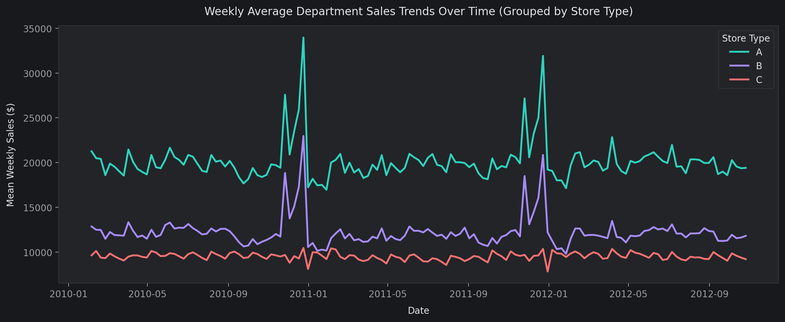

Mean weekly department sales.

## Four-feature exploratory store PCA

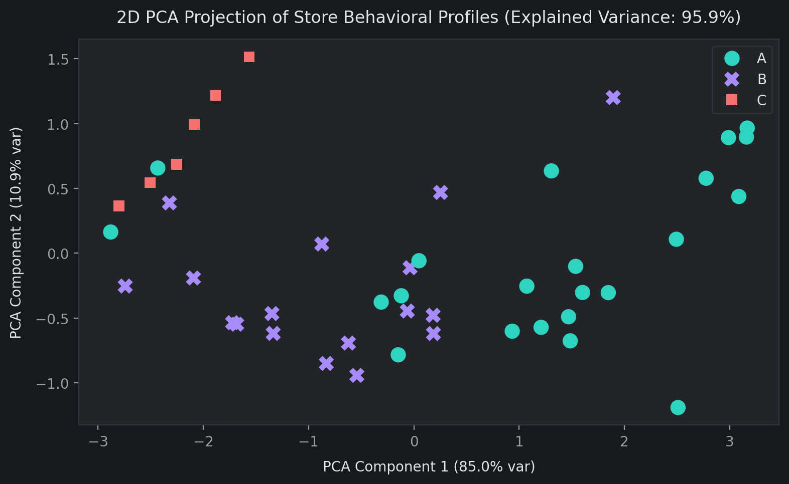

Separate from the eight-feature segmentation PCA.

## Top-ten department correlations

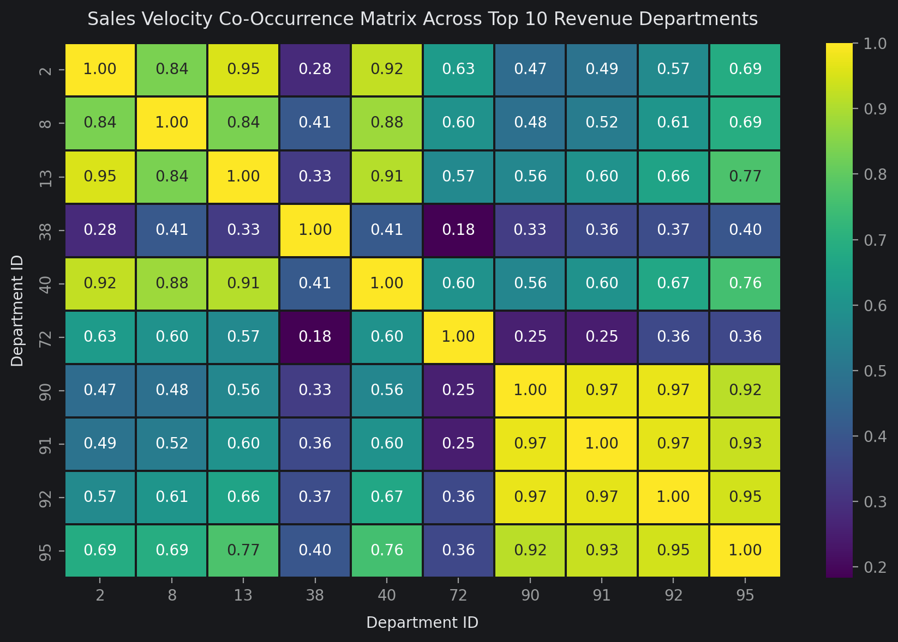

Complete co-observed Store-Date rows.

## Signed target correlations

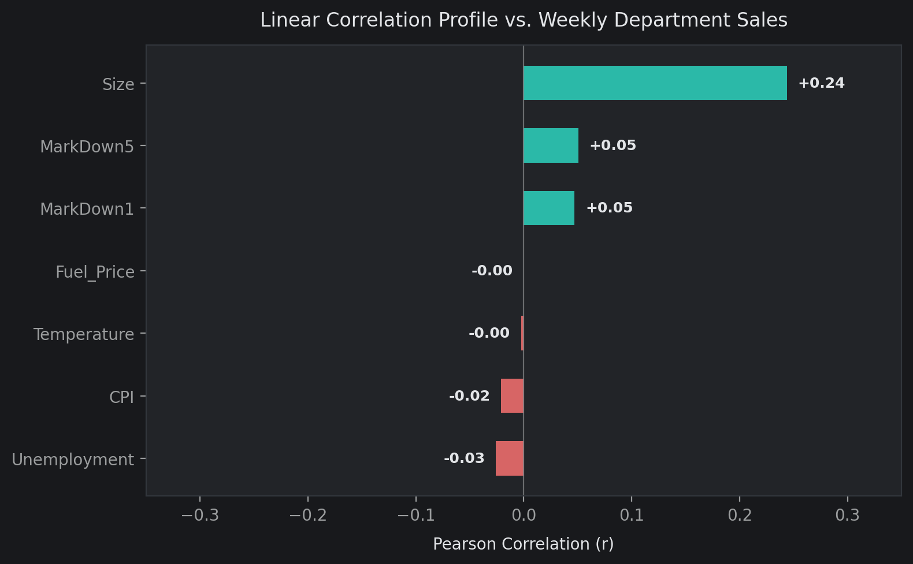

Correlation does not establish causal influence.

## K-means diagnostics

Inertia, silhouette and Davies-Bouldin for k=2–6.

## Three store personas

PCA projection and group sizes; k=3 is explicitly specified.

## Department rule space

503,958 filtered high-sales co-movement rules; no customer baskets.

## Tuned LightGBM holdout diagnostics

Parity sample and adjusted-target residual distribution.

## LightGBM feature split counts

Default split importance; the chart axis incorrectly says gain.

